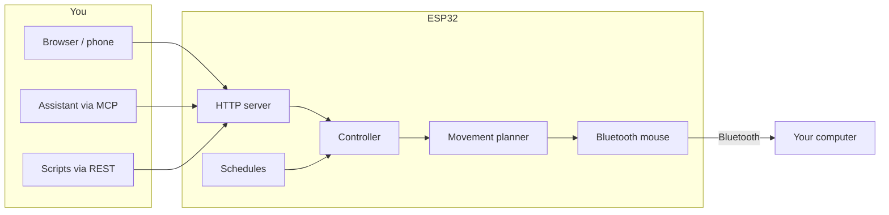

<h1 align="center">Jiggler</h1>

<p align="center">
  <b>A tiny ESP32 that keeps a computer awake by pretending to be a Bluetooth mouse.</b><br>
  Control it from a clean web dashboard, a REST API, or straight from your AI assistant.
</p>

<p align="center">
  
</p>

Nothing to install on the computer. It sees an ordinary Bluetooth mouse (a plain "Bluetooth Mouse" by default; give it your own name or pick a real model if you like), and the board nudges the cursor now and then the way a hand would: curved paths, smooth acceleration, random timing, and a return to where it started so the pointer never drifts.

## Why it is nice to live with

- **Safe by default.** Pairing is *closed* until you open it, for 3 minutes, from the dashboard or with one tap on the board. A stranger in Bluetooth range cannot pair. Everything else sits behind a token.
- **Guided first setup.** A new board walks you through it: connect, open pairing, pick the device on your computer. You are done in a minute.
- **You decide when it runs.** Start it for 5, 10 or 30 minutes, until a time of day, or until you stop it. Or set weekly schedules ("Mon-Fri, 09:00 for 8 hours") and forget about it.
- **Always know what it is doing.** The dashboard shows which computer is connected and since when, when the next movement happens, and when a timed run ends.
- **Disconnect without unplugging.** Drop the link and keep the device from connecting until you press Reconnect, rename computers, forget the ones you no longer use.
- **Works without internet.** The Bluetooth mouse never depends on WiFi. No WiFi at all? The board can create its own network.
- **Talk to it.** A built-in [MCP](docs/mcp.md) server lets an assistant answer "is it running?", "keep it on for 30 minutes", or "run it Monday to Friday, 9 to 6".

## See it

<p align="center">
  
  
  
</p>

<p align="center">
  
  
  
</p>

The page adapts to phones and desktops, follows your light or dark theme, and can be added to a phone's home screen. [Take the full tour](docs/dashboard.md).

## Quick start

You need a classic **ESP32 dev board** (`esp32dev`), a **USB cable and a stable USB power source**, and [PlatformIO](https://platformio.org) (`pipx install platformio`).

```sh
git clone git@github.com:carlosatta/jiggler.git && cd jiggler
pio run -e esp32 -t upload          # build and flash (add --upload-port /dev/cu.usbserial-XXXX if needed)
pio device monitor                  # optional: watch the log at 115200 baud
```

Then, in about a minute:

1. **Join `Jiggler-Setup`** (a WiFi network the board opens by itself), pick your WiFi and choose a token. The board restarts.
2. **Open `http://jiggler.local/`** and enter the token. The page guides you: press *Open pairing* (or tap the BOOT button once on the board).
3. **On the computer**, open the Bluetooth settings and choose *Bluetooth Mouse*.

That is it: press **Start**. The full walkthrough, with screenshots and troubleshooting, is in [Getting started](docs/getting-started.md).

## Control it from anywhere

```sh
TOKEN=your-token
curl -H "Authorization: Bearer $TOKEN" http://jiggler.local/api/status
curl -H "Authorization: Bearer $TOKEN" -H 'Content-Type: application/json' \
     -d '{"minutes": 30}' http://jiggler.local/api/start            # run for 30 minutes
```

For an assistant, add the device as an MCP server:

```sh
claude mcp add --transport http jiggler http://jiggler.local/mcp \
  --header "Authorization: Bearer <token>"
```

See the [REST API](docs/api.md) and the [MCP tools](docs/mcp.md).

## How it works



All logic lives in a hardware-free core that is tested on a laptop; the firmware is a thin layer over it. [Architecture](docs/architecture.md).

## Good to know

- **One Bluetooth identity.** A classic ESP32 has one Bluetooth address, so the device shows up as one mouse. Several computers can be paired (up to 3), one connected at a time. [Bluetooth](docs/bluetooth.md).
- **Skin-deep identity.** If you pick a real mouse model, the device presents that model's name and identifiers but does not implement the vendor's proprietary protocol; vendor software will not treat it as the real thing.
- **Plain HTTP.** The token travels unencrypted: use it on a network you trust. Because of that, browsers offer "Add to Home Screen" rather than a full app install.
- **Schedules need the time**, which the board gets from the internet; in own-network mode there is no clock. [Schedules](docs/schedules.md).
- **Updates over WiFi (OTA)** from the dashboard once the board has been flashed over USB with the OTA partition table (a one-time step). A firmware that starts but is broken needs a USB cable to recover. [Updating](docs/getting-started.md#updating-the-firmware-later-no-cable).
- **Cursor drift is unmeasured.** The cursor returns exactly in mouse counts, but your operating system's pointer acceleration can leave a visible offset.

## Documentation

| | |
|---|---|
| [Getting started](docs/getting-started.md) | Flash, first setup, pairing, troubleshooting |
| [Dashboard tour](docs/dashboard.md) | Every section of the page |
| [Bluetooth](docs/bluetooth.md) | Pairing policy, disconnecting, which computer is which |
| [Schedules and timed runs](docs/schedules.md) | Run for a while, or on a weekly timetable |
| [Appearance](docs/appearance.md) | How the device introduces itself to computers |
| [Network and security](docs/network.md) | WiFi, own network, the token, the LED |
| [REST API](docs/api.md) · [MCP](docs/mcp.md) | Control it from code or an assistant |
| [Architecture](docs/architecture.md) · [Development](docs/development.md) | For contributors |

## Responsible use

This is meant for keeping your own computer awake. Company-managed machines may run tools that detect new peripherals or activity patterns, and many workplaces have policies about this. Check yours before using it on a managed device.

## Project status

Firmware, dashboard, REST and MCP are implemented and covered by host unit tests (`pio test -e native`); hardware behaviour is verified on a board by hand. See the [changelog](CHANGELOG.md). Scripts, automations and a keyboard mode were built and then parked to keep the product focused: they remain in the code and in the git tag `v0.3.1-with-scripts-keyboard`.
