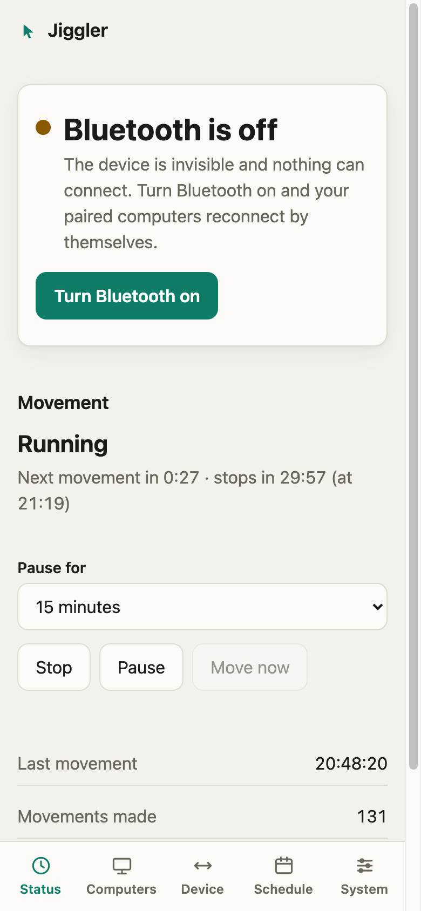

# Bluetooth: states, pairing and computers

The board is a Bluetooth peripheral with **one** identity (see [Appearance](appearance.md)). One computer is connected at a time, but up to **3** can be paired; the board reconnects to whichever one is in range.

  
  

## The four states

| State | What it means | Who can find and reach the device |
|---|---|---|
| **Off** | The radio is silent. | Nobody. The device is invisible and cannot be connected to. |
| **Waiting** | On, not connected, **Discovery closed**. | Only computers that are already paired. The device is not discoverable and does not show its name, so it does not appear in anyone else's "nearby devices" list. |
| **Discovery** | On, and a window is open so a **new computer can pair**. | Everyone in range: the device is discoverable and shows its name. |
| **Connected** | Linked to a computer. | (Discovery, when open, wins in the status so you can see it is open.) |

The state is `state` (`off`, `waiting`, `discovery`, `connected`) in `GET /api/bluetooth` and in the `bluetooth` object of `GET /api/status`. The status LED shows it too (see [Network and security](network.md#the-status-led)).

## Discovery: pairing is always closed until you open it

A new computer can pair only while Discovery is open. By default it is **closed**, always: a brand-new board, a board with computers paired, after "Forget all". A computer that tries to pair while it is closed is refused, and its bond, if it made one, is removed.

You open Discovery from **Computers → Start Discovery**, with `POST /api/bluetooth/pairing` (optional body `{"seconds": 120}`), with the `start_pairing` MCP tool, with a schedule action, or by **holding the button on the board for 5 to 10 seconds and letting go** (the LED blinks fast while you can let go). If Bluetooth was off, opening Discovery switches it on. It lasts **180 seconds by default**; change that on Computers (30 to 600 s, `PUT /api/bluetooth/settings {"discoverySeconds": 300}`). It closes by itself when the time is up, when a computer pairs, or when you stop it (`DELETE /api/bluetooth/pairing`).

To pair the very first computer on a new board you need either the board in your hand (the button) or the token (the dashboard): nobody else can do it.

**How it is enforced.** While Discovery is closed the board refuses at the start of pairing (it claims it can confirm a code and always declines), which stops even a computer that merely forgot the device from re-pairing. Hosts that cannot show a code are caught by a second check: as soon as the board learns the newcomer's identity its link is dropped and its bond, if any, is deleted. Computers that are already paired are never affected. Any new bond closes Discovery, so whoever pairs first in range uses it up: pair your computer yourself, promptly, and look at **Computers** afterwards.

**At most 3 computers** can be paired. A fourth is refused even while Discovery is open: forget one first. (The Bluetooth stack keeps 5 bond slots and evicts the oldest when full; the spare slots keep a refused newcomer from ever pushing a real bond out.)

## Turning Bluetooth off and on

**Turn Bluetooth off** (`POST /api/bluetooth/disable`, MCP `disable_bluetooth`, or a schedule action) disconnects the computer, closes Discovery and silences the radio. Pairings are kept. **Turn Bluetooth on** (`POST /api/bluetooth/enable`) lets the paired computers find the device and reconnect by themselves. The choice is stored, so a restart does not undo it.

When the **computer itself** ends the connection — *Disconnect* in its own Bluetooth menu, going to sleep, or its Bluetooth being switched off — the device goes back to **Waiting** and keeps advertising, so that computer reconnects by itself when it comes back, like any other mouse. That is the default.

The setting **Turn Bluetooth off when the computer itself disconnects** changes it (`PUT /api/bluetooth/settings {"offWhenComputerDisconnects": true}`): the board then switches Bluetooth off until you turn it on again, and the event log says why. Tick it if you want *Disconnect* on the computer to stick, because otherwise the computer reconnects at once (macOS does). A board updated from a version before 0.7.6, where the setting was ticked by default, has it turned off once; if you tick it yourself afterwards, that choice is kept.

> **Sleep.** A computer going to sleep sends exactly what it sends when you press Disconnect, and the board cannot tell the two apart. With the setting ticked, closing the lid switches Bluetooth off, and the computer cannot reconnect after waking until you turn it on again from the dashboard. That is why it is off by default.

A peripheral cannot tell a deliberate "Connect" click on the computer from its automatic reconnection, so while Bluetooth is off nothing can connect, not even by hand.

## Which computer is connected?

Bluetooth does not give a peripheral the computer's name, only its address, so the board numbers computers ("Computer 1", "Computer 2", …) and stores any name you give them (**Rename**, or `PUT /api/bluetooth/peers/<id>`, 1–32 characters). To tell them apart: turn Bluetooth off, see which computer loses the mouse, and rename the one marked *Connected now*.

## Forgetting

**Forget** (`DELETE /api/bluetooth/peers/<id>`) removes one bond on the board and drops that computer's link if it is connected. **Forget all** (`DELETE /api/bluetooth/peers`) removes all of them; Discovery stays closed until you open it. **Also remove the device in the computer's Bluetooth settings**, otherwise that computer keeps a stale key and may fail to reconnect until you do.

## Limits

- The board has no display or keypad, so pairing is "Just Works": anyone in radio range while Discovery is open can pair. Keep it short.
- A refused intruder briefly holds an encrypted link before it is dropped.
- A link that connects and never starts pairing is not refused by the policy; it cannot receive input reports without encryption. Turn Bluetooth off if you suspect one.
- In **Waiting** the device is not discoverable, which hides it from the "nearby devices" lists, but a determined scanner can still see that something is advertising. It is a courtesy, not a security boundary: the security is that pairing is refused.
- Names are stored on the board, never read from the computer.
