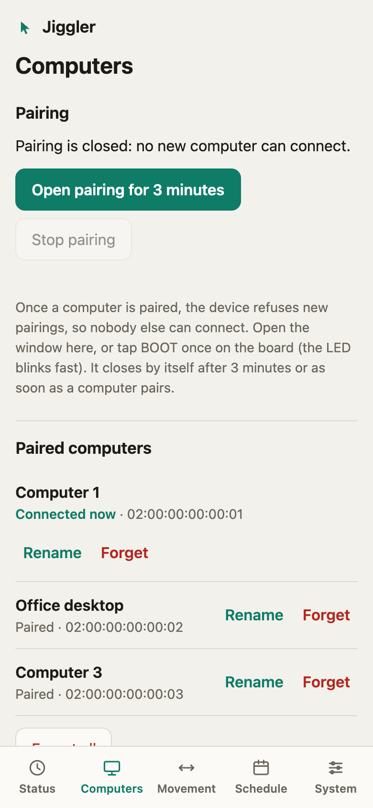
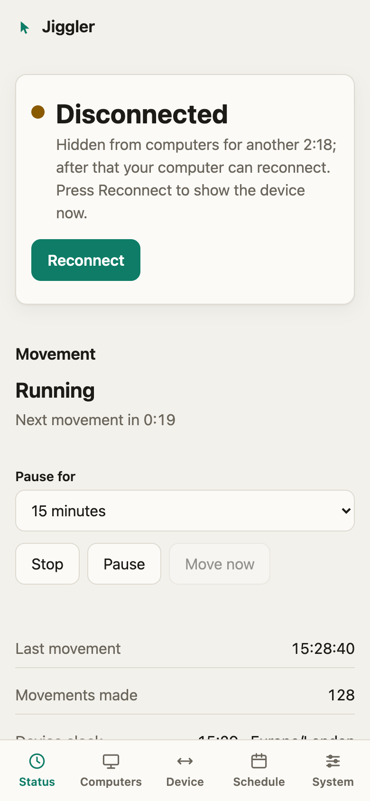

# Bluetooth: pairing, computers and disconnecting

The board is a Bluetooth peripheral with **one** identity (see [Appearance](appearance.md)). One computer is connected at a time, but up to **3** can be paired; the board reconnects to whichever one is in range.

  
  

## Pairing is always closed, until you open it

| Situation | Pairing |
|---|---|
| Default, **always**: a brand-new board, a board with computers paired, after "Forget all" | **Closed.** A computer that tries to pair is refused, and its bond, if it made one, is removed. |
| Window opened by you | Open for **3 minutes** (the API also accepts 30–600 s), then it closes by itself. It closes earlier if you stop it, or **as soon as a new computer pairs**. |

Open a window from **Computers → Open pairing**, with `POST /api/bluetooth/pairing`, with the `start_pairing` MCP tool, or with a **short tap of the BOOT button** on the board (the LED blinks fast while it is open). The dashboard shows a countdown; stop it early with **Stop pairing** (`DELETE /api/bluetooth/pairing`).

To pair the very first computer on a new board you therefore need either the board in your hand (the BOOT tap) or the token (the dashboard): nobody else can do it.

**How it is enforced.** While the window is closed the board refuses at the start of pairing (it claims it can confirm a code and always declines), which stops even a computer that merely forgot the device from re-pairing. Hosts that cannot show a code are caught by a second check: as soon as the board learns the newcomer's identity its link is dropped and its bond, if any, is deleted. Computers that are already paired are never affected. Any new bond closes the window, so whoever pairs first in range uses it up: pair your computer yourself, promptly, and look at **Computers** afterwards.

**At most 3 computers** can be paired. A fourth is refused even while a window is open: forget one first. (The Bluetooth stack keeps 5 bond slots and evicts the oldest when full; the spare slots keep a refused newcomer from ever pushing a real bond out.)

## Which computer is connected?

Bluetooth does not give a peripheral the computer's name, only its address, so the board numbers computers ("Computer 1", "Computer 2", …) and stores any name you give them (**Rename**, or `PUT /api/bluetooth/peers/<id>`, 1–32 characters). To tell them apart: disconnect, see which computer loses the mouse, and rename the one marked *Connected now*.

## Disconnect (without powering off)

**Disconnect** (`POST /api/bluetooth/disconnect`) drops the link, closes any open pairing window and **hides the device until you reconnect it**: advertising stops, so no computer can reconnect. A paired computer reconnects within seconds on its own, so hiding is what makes the disconnect stick. **Reconnect** (`POST /api/bluetooth/reconnect`) or opening a pairing window makes the device visible again. The hold is not persisted: a restart brings the device back. The status reports `held: true` with `heldRemainingMs: null` (no countdown).

A peripheral cannot tell a deliberate "connect" click on the computer from its automatic reconnection, so while the device is hidden nothing can connect.

### When the computer disconnects

If you press *Disconnect* in the computer's own Bluetooth menu, the board sees the computer end the connection and hides the device, but only for 3 minutes (`heldRemainingMs` counts down), so the computer can come back by itself afterwards, which a dashboard Disconnect does not allow (without this, macOS reconnects immediately because the device keeps advertising). A connection lost for other reasons (out of range, computer asleep or off) is not affected, and neither is a drop during pairing.

## Forgetting

**Forget** (`DELETE /api/bluetooth/peers/<id>`) removes one bond on the board and drops that computer's link if it is connected. **Forget all** (`DELETE /api/bluetooth/peers`) removes all of them; pairing stays closed until you open a window. **Also remove the device in the computer's Bluetooth settings**, otherwise that computer keeps a stale key and may fail to reconnect until you do.

## Limits

- The board has no display or keypad, so pairing is "Just Works": anyone in radio range while a window is open can pair. Keep windows short.
- A refused intruder briefly holds an encrypted link before it is dropped.
- A link that connects and never starts pairing is not refused by the policy; it cannot receive input reports without encryption. Hide the device with Disconnect if you suspect one.
- The device is always visible in a computer's Bluetooth list (it must be, so paired computers can reconnect); it just cannot be paired with.
- Names are stored on the board, never read from the computer.
