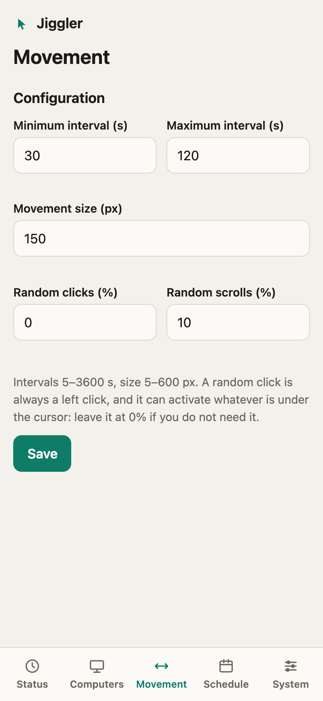
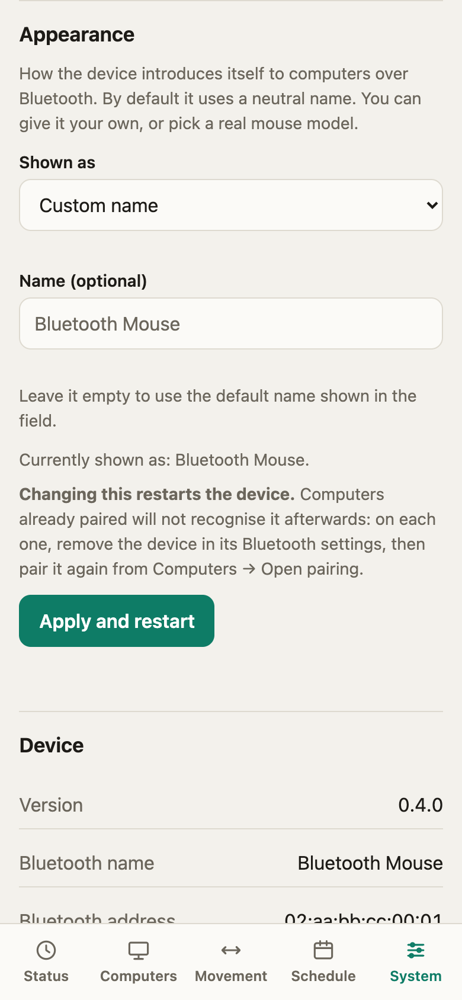

# Dashboard tour

The dashboard is a single page served by the board at `http://jiggler.local/`. It works on phones (bottom bar) and desktops (side bar), follows your light or dark theme, and signs in with your [token](network.md#the-token). Five sections.

  

## Status

The first thing you see: **which computer is connected and since when**, and what the jiggler is doing.

  
  

- **Connection.** *Connected to Computer 1, for 12 minutes.* **Disconnect** drops the link and hides the device for 3 minutes, so the computer does not reconnect at once (it does not power the device off). While hidden, the card counts down and offers **Reconnect**.
- **Movement.** *Running* or *Stopped*, the time to the next movement, and, for a timed run, when it will stop.
- **Run for** (shown while stopped): *until I stop it*, 5, 10 or 30 minutes, 1 hour, *until a time of day*, or a custom number of minutes (1 to 1440). **Start** applies it; **Move now** makes one movement immediately.
- **Facts.** Last movement, movements made, the device clock (with its timezone) and WiFi.

On a new board, Status shows the guided **Set up your Jiggler** card until a computer is paired ([Getting started](getting-started.md)). The jiggler cannot start before that.

## Computers

  

- **Pairing** is closed by default. **Open pairing for 3 minutes** lets one new computer pair; it closes by itself after 3 minutes or as soon as a computer pairs, and **Stop pairing** closes it earlier.
- **Paired computers.** Bluetooth does not tell the device a computer's name, so they are numbered. **Rename** gives one a name you will recognise; **Forget** removes it (confirm with a second tap); **Forget all** removes every one. Up to 3 can be paired.

Details and the reasoning are in [Bluetooth](bluetooth.md).

## Movement

  

How a movement looks and how often it happens: the minimum and maximum interval between movements, the movement size, and the chance of a random click (always a left click) or scroll. Defaults are conservative: 30 to 120 seconds, 150 px, no clicks, a few scrolls.

## Schedule

  

Weekly windows that start and stop the jiggler for you, in the **timezone** you pick: choose the days, a start time and how long it lasts (a window may run past midnight). Details in [Schedules](schedules.md).

## System

  
  

- **Security.** Change the token (you need the current one).
- **Network.** *Auto* (your home WiFi, with the setup network as a fallback) or *Own network* (the board creates a protected WiFi network). The own-network password is optional: leave it empty and one is generated the first time. See [Network](network.md).
- **Appearance.** The name the device shows over Bluetooth: a neutral "Bluetooth Mouse" by default, a name of your own, or a real mouse model. Changing it restarts the device and needs each computer to pair again. See [Appearance](appearance.md).
- **Device.** Firmware version, Bluetooth name and address, and **Restart**.

## When something goes wrong

The page says so plainly: a banner appears if the device cannot be reached and it retries by itself; after a restart it reconnects on its own and tells you when the device is back.
