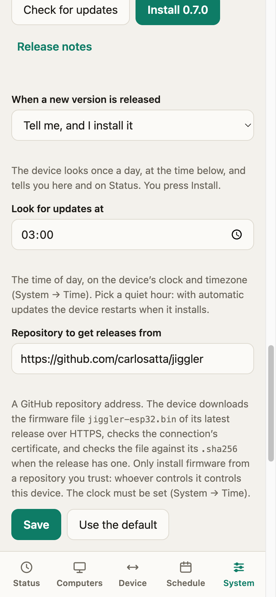

# Getting started

From a bare ESP32 to a computer that stays awake, in about ten minutes.

## What you need

- A classic **ESP32 dev board** (`esp32dev`, the common 30-pin or 38-pin kit with a USB-serial chip). Other ESP32 variants (S2, S3, C3) are not tested or supported.
- A **USB cable that carries data** and a **stable USB power source** (a wall adapter or a monitor port). A weak port or a thin cable can make the board reset when the radio starts; see [Troubleshooting](#troubleshooting).
- [PlatformIO](https://platformio.org): `pipx install platformio`.
- A computer or phone with Bluetooth to keep awake, and a 2.4 GHz WiFi network.

## 1. Flash the firmware

```sh
git clone git@github.com:carlosatta/jiggler.git
cd jiggler
pio run -e esp32 -t upload --upload-port /dev/cu.usbserial-0001   # your port will differ
pio device monitor                                                # optional, 115200 baud
```

On a board you have used before, erase it first for a true clean start (this removes WiFi, token and pairings):

```sh
pio run -e esp32 -t erase --upload-port /dev/cu.usbserial-0001
```

## 2. Tell it your WiFi and choose a token

A new board opens a WiFi network called **`Jiggler-Setup`** and the serial log says `setup portal 'Jiggler-Setup' started`.

1. Join `Jiggler-Setup` from a phone or laptop. A setup page opens by itself (or browse to `192.168.4.1`).
2. Choose your WiFi, enter its password, and set the **API token**: the password for the dashboard, the API and MCP. Use 8 to 40 characters, no spaces. Write it down.
3. Press save. If the WiFi password is wrong the setup page stays open, so try again. When it connects, **the board restarts once** by itself and joins your WiFi.

## 3. Open the dashboard

Browse to **`http://jiggler.local/`** from a device on the same network (or use the IP address your router shows, also printed in the serial log), and sign in with your token.

A board with no paired computer shows **Set up your Jiggler**:

<p align="center">
  
  
  
</p>

1. Press **Start Discovery**. (Or hold the **BOOT** button for 5 to 10 seconds and let go; the LED blinks fast while Discovery is open.)
2. On the computer, open the Bluetooth settings and choose **Bluetooth Mouse** (the name you will see; you can change it later in **System → Appearance**). The page updates by itself as soon as it connects, and Discovery closes.
3. Press **Start**.

The jiggler **cannot run until a computer is paired**, so nothing moves before this step is done.

## 4. Use it

- **Run for** lets you start it for 5, 10 or 30 minutes, an hour, until a time of day, or until you stop it.
- **Schedule** runs it automatically on a weekly timetable ([schedules](schedules.md)).
- **Computers** shows what is paired, lets you turn Bluetooth off and on, rename, forget and pair another ([Bluetooth](bluetooth.md)).

Add the page to your phone's home screen from the browser menu for a full-screen shortcut.

## Updating the firmware later (no cable)

Once the board has been flashed over USB with a build that has OTA (0.5.0 or later), you can update it over WiFi. There are three ways.

<p align="center">
  
</p>

**1. From the project's releases (GitHub).** In **System → Firmware updates** the device looks at the latest release of a repository (by default [carlosatta/jiggler](https://github.com/carlosatta/jiggler)) once a day, **at a time you choose** (default 03:00, on the device's clock and timezone), and you choose what it does when a new version appears:

| Setting | What happens |
|---|---|
| **Tell me, and I install it** (default) | The dashboard says "Version X is available" (also on Status). You press **Install**. |
| **Install it automatically** | At that time the device downloads and installs the new version by itself, then restarts (the jiggler and Bluetooth are off for a minute or so), so pick a quiet hour. |
| **Ignore it** | It never looks by itself (the time does not apply). **Check for updates** still works whenever you press it. |

The **repository** is a field you can change (for example to your own fork); **Use the default** puts the project's repository back. The same settings are in `GET/PUT /api/updates` and the `get_updates` / `set_updates` tools. Needs: the board online, and its **clock set** (System → Time), because the secure connection checks certificate dates and the time of day is read on that clock. A board that is off at the chosen time looks as soon as it is back (about ten minutes after boot); a look that fails is retried every hour. While it installs, the jiggler stops and Bluetooth is off (the computer sees a disconnect); the device restarts when it is done, and also if the install failed (the dashboard then shows why). The download is over HTTPS with the certificate verified against the standard list of public certificate authorities, and is checked against the release's `.sha256` file. **Only follow a repository you trust**: whoever can publish a release there can change what runs on your device. The firmware file must be named `jiggler-esp32.bin` (releases of this project have it).

If an installed version does not start, the board falls back to the previous one; an automatic update never retries a version that did not take effect.

**2. From a file, in the dashboard:** System → **Install from a file**, choose `.pio/build/esp32/firmware.bin`, **Upload and restart**. The page shows the progress and reconnects when the board is back.
**3. From a terminal:**
  ```sh
  pio run -e esp32
  curl -H "Authorization: Bearer $TOKEN" -F firmware=@.pio/build/esp32/firmware.bin http://jiggler.local/api/update
  ```

Your token, WiFi, pairings and schedules are kept. A file that is not a valid ESP32 firmware is refused and nothing changes. The board keeps two application slots, so a build that cannot even start falls back to the previous one; a build that starts but is broken in some other way (for example one that cannot join WiFi) needs a USB cable to recover. **The very first OTA-capable flash has to be done over USB**, because it changes the partition table.

## No WiFi at home?

Switch the board to **own network** mode: it creates a protected WiFi network that serves the dashboard at `192.168.4.1`. Hold the **BOOT** button for 30 seconds to switch between the two modes (the board restarts), or change it in **System → Network**. See [Network](network.md). Schedules need the time, which a board with no internet only has if you set it by hand in **System → Time** (it is lost at every restart).

## Troubleshooting

**The board resets over and over, with "Brownout detector was triggered" in the log.** The power supply sags when the WiFi radio starts. Use a different USB port or a short, good-quality cable, or a wall adapter. Avoid unpowered hubs.

**I joined `Jiggler-Setup` but the setup page does not open.** Browse to `http://192.168.4.1/`. Make sure your phone has not switched back to a network with internet.

**The setup page keeps coming back after I save.** The WiFi password is wrong, or the network is 5 GHz only (the ESP32 needs 2.4 GHz). Try again.

**`jiggler.local` does not load.** Use the IP address shown in the serial log or your router. Some networks block mDNS.

**The dashboard says "Device not reachable".** The board restarted, lost WiFi, or lost power. The page retries by itself.

**Pairing fails, or the device is not in the list.** Start Discovery first (it is closed by default, on purpose), then choose the device on the computer before it closes. While Discovery is closed the device does not show up in other computers' lists at all. If the computer paired before and has since forgotten the device, forget the computer under **Computers** too and pair again. Only up to 3 computers can be paired.

**It connected, then Bluetooth switched itself off.** Pressing Disconnect in the computer's own Bluetooth menu (or the computer going to sleep) switches Bluetooth off, so the computer does not reconnect behind your back. Press **Turn Bluetooth on** on the dashboard, or untick the setting under **Computers → Discovery**.

**Back to a clean slate.** `pio run -e esp32 -t erase`, then flash again. This removes WiFi, token, pairings and schedules.
