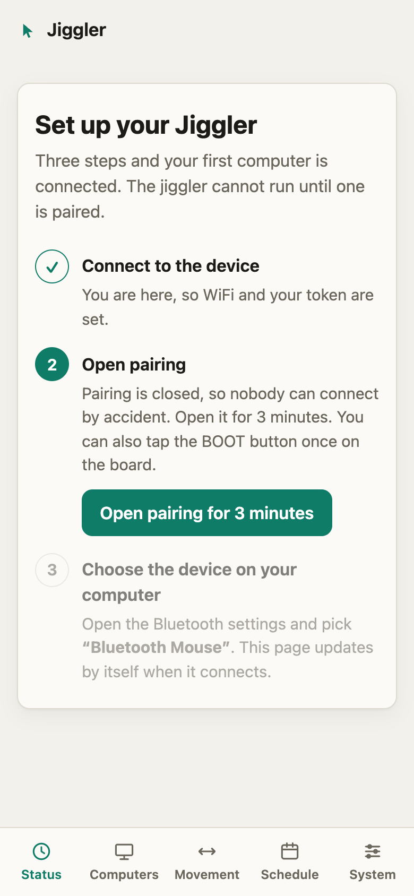
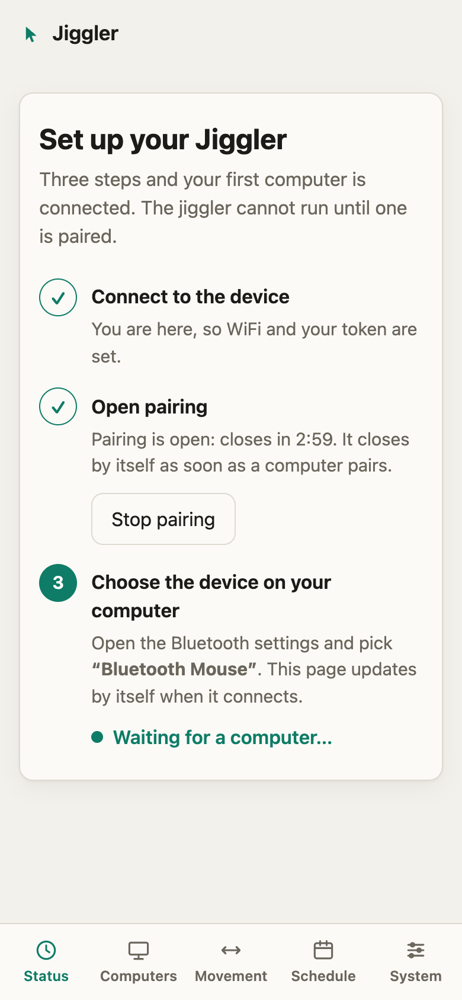
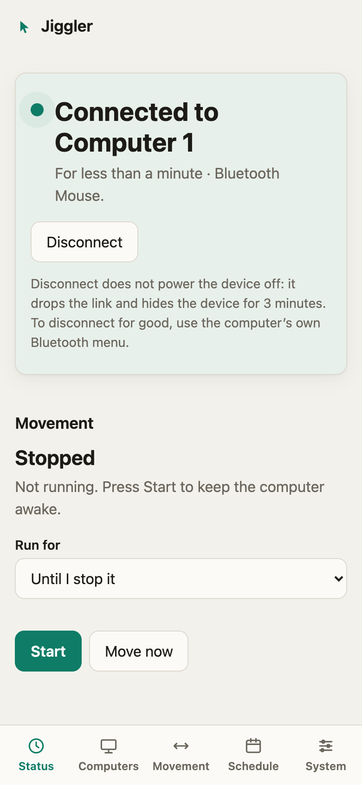

# Getting started

From a bare ESP32 to a computer that stays awake, in about ten minutes.

## What you need

- A classic **ESP32 dev board** (`esp32dev`, the common 30-pin or 38-pin kit with a USB-serial chip). Other ESP32 variants (S2, S3, C3) are not tested or supported.
- A **USB cable that carries data** and a **stable USB power source** (a wall adapter or a monitor port). A weak port or a thin cable can make the board reset when the radio starts; see [Troubleshooting](#troubleshooting).
- [PlatformIO](https://platformio.org): `pipx install platformio`.
- A computer or phone with Bluetooth to keep awake, and a 2.4 GHz WiFi network.

## 1. Flash the firmware

```sh
git clone git@github.com:carlosatta/jiggler.git
cd jiggler
pio run -e esp32 -t upload --upload-port /dev/cu.usbserial-0001   # your port will differ
pio device monitor                                                # optional, 115200 baud
```

On a board you have used before, erase it first for a true clean start (this removes WiFi, token and pairings):

```sh
pio run -e esp32 -t erase --upload-port /dev/cu.usbserial-0001
```

## 2. Tell it your WiFi and choose a token

A new board opens a WiFi network called **`Jiggler-Setup`** and the serial log says `setup portal 'Jiggler-Setup' started`.

1. Join `Jiggler-Setup` from a phone or laptop. A setup page opens by itself (or browse to `192.168.4.1`).
2. Choose your WiFi, enter its password, and set the **API token**: the password for the dashboard, the API and MCP. Use 8 to 40 characters, no spaces. Write it down.
3. Press save. If the WiFi password is wrong the setup page stays open, so try again. When it connects, **the board restarts once** by itself and joins your WiFi.

## 3. Open the dashboard

Browse to **`http://jiggler.local/`** from a device on the same network (or use the IP address your router shows, also printed in the serial log), and sign in with your token.

A board with no paired computer shows **Set up your Jiggler**:

<p align="center">
  
  
  
</p>

1. Press **Open pairing for 3 minutes**. (Or tap the **BOOT** button once on the board; the LED blinks fast while pairing is open.)
2. On the computer, open the Bluetooth settings and choose **Bluetooth Mouse** (the name you will see; you can change it later in **System → Appearance**). The page updates by itself as soon as it connects, and pairing closes.
3. Press **Start**.

The jiggler **cannot run until a computer is paired**, so nothing moves before this step is done.

## 4. Use it

- **Run for** lets you start it for 5, 10 or 30 minutes, an hour, until a time of day, or until you stop it.
- **Schedule** runs it automatically on a weekly timetable ([schedules](schedules.md)).
- **Computers** shows what is paired, lets you disconnect, rename, forget and pair another ([Bluetooth](bluetooth.md)).

Add the page to your phone's home screen from the browser menu for a full-screen shortcut.

## No WiFi at home?

Switch the board to **own network** mode: it creates a protected WiFi network that serves the dashboard at `192.168.4.1`. Hold the **BOOT** button for 3 seconds to switch between the two modes (the board restarts), or change it in **System → Network**. See [Network](network.md). Schedules need the internet for the time, so they do nothing in this mode.

## Troubleshooting

**The board resets over and over, with "Brownout detector was triggered" in the log.** The power supply sags when the WiFi radio starts. Use a different USB port or a short, good-quality cable, or a wall adapter. Avoid unpowered hubs.

**I joined `Jiggler-Setup` but the setup page does not open.** Browse to `http://192.168.4.1/`. Make sure your phone has not switched back to a network with internet.

**The setup page keeps coming back after I save.** The WiFi password is wrong, or the network is 5 GHz only (the ESP32 needs 2.4 GHz). Try again.

**`jiggler.local` does not load.** Use the IP address shown in the serial log or your router. Some networks block mDNS.

**The dashboard says "Device not reachable".** The board restarted, lost WiFi, or lost power. The page retries by itself.

**Pairing fails, or the device is not in the list.** Open pairing first (it is closed by default, on purpose), then choose the device on the computer within 3 minutes. If the computer paired before and has since forgotten the device, forget the computer under **Computers** too and pair again. Only up to 3 computers can be paired.

**It connected, then disconnected after I pressed Disconnect.** That is intended: the device hides for 3 minutes so the computer does not reconnect at once. Press **Reconnect** to end it early.

**Back to a clean slate.** `pio run -e esp32 -t erase`, then flash again. This removes WiFi, token, pairings and schedules.
