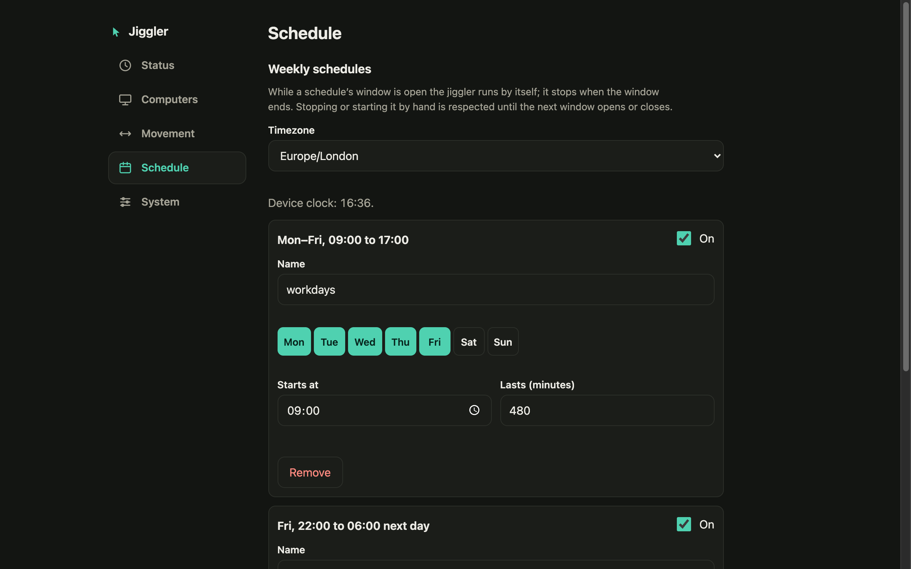

# Timed runs and schedules

Two ways to have the jiggler start and stop without you.

## Run for a while

On **Status**, choose how long before pressing **Start**: *until I stop it*, **5, 10 or 30 minutes**, **1 hour**, **until a time of day**, or a **custom number of minutes** (1 to 1440).

<p align="center">
  
</p>

The same over the API is `POST /api/start` with `{"minutes": 30}`, and over MCP the `start` tool's `minutes` argument. "Until 15:40" is turned into minutes by the dashboard using the browser's clock, so it works even when the device has no clock of its own. The remaining time is `stopsInMs` in the status. A plain Start, Pause or Stop clears the limit.

## Weekly schedules

In the **Schedule** section, a schedule is a window: **on these days, from this time, for this long**. While a window is open the jiggler runs; when it ends the jiggler stops.

<p align="center">
  
  
</p>

Up to 8 schedules, each with a name, an on/off switch, days (Mon to Sun), a start time and a duration of 1 to 1440 minutes. A window may run past midnight: Friday 22:00 for 8 hours ends Saturday 06:00 and belongs to Friday. Pick the **timezone** at the top of the section (the list is built in; daylight saving is handled). Several schedules can overlap; the jiggler runs while any enabled window is open.

```json
{ "timezone": "Europe/London",
  "schedules": [
    { "id": "workdays", "enabled": true, "days": ["mon","tue","wed","thu","fri"], "start": "09:00", "durationMin": 540 },
    { "id": "night-job", "enabled": true, "days": ["fri"], "start": "22:00", "durationMin": 480 } ] }
```

(`id` is the "Name" field in the dashboard: 1 to 24 characters of `a-z 0-9 _ -`.) The API is `GET/PUT /api/schedules` and the MCP tools are `get_schedules` and `set_schedules`.

### How it behaves

- **Edges, not enforcement.** A schedule starts the jiggler when a window opens and stops it when the last open window closes. If you stop it by hand in the middle of a window it stays stopped until the next window opens; if you start it by hand outside a window it keeps running until you stop it.
- **After a restart** the schedule is in charge: once the device knows the time, the jiggler matches whether a window is open. With no enabled schedule the jiggler boots running if a computer is paired, as before.
- **Saving a schedule never starts or stops anything** by itself, including when the device has no clock yet (once it has one, only a window opening or closing acts).
- **A window opening takes over a timed run.** If you started "run for 30 minutes" and a window opens meanwhile, the time limit is dropped and the jiggler runs until the window closes.
- **It needs a computer paired.** The jiggler cannot run with nothing paired; a window that opens before the first pairing starts the jiggler once a computer pairs.
- **It needs the time.** The device gets it from the internet (SNTP), so it needs your home WiFi with internet access; in own-network mode there is no clock and schedules do nothing. The dashboard says "Not synced" until the clock is known, and the status reports `timeSynced`.
- **Daylight-saving changes.** Windows are matched on the local clock time, so a window that spans the hour that repeats (autumn) or is skipped (spring) can run twice or not at all that one night.
