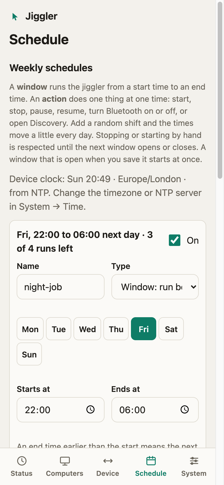

# Timed runs and schedules

Two ways to have the jiggler start and stop without you.

## Run for a while

On **Status**, choose how long before pressing **Start**: *until I stop it*, **5, 10 or 30 minutes**, **1 hour**, **until a time of day**, or a **custom number of minutes** (1 to 1440).

<p align="center">
  
</p>

The same over the API is `POST /api/start` with `{"minutes": 30}`, and over MCP the `start` tool's `minutes` argument. "Until 15:40" is turned into minutes by the dashboard using the browser's clock, so it works even when the device has no clock of its own. The remaining time is `stopsInMs` in the status. A plain Start, Pause or Stop clears the limit.

## Weekly schedules

In the **Schedule** section you add up to 8 entries. Each has a name, an on/off switch, the days (Mon to Sun) and one of two types.

<p align="center">
  
  
  
</p>

**Window: run between two times.** On these days, from a start time to an end time. While a window is open the jiggler runs; it starts when the window opens and stops when it closes. An end earlier than the start means the next day (Friday 22:00 to 06:00 ends Saturday morning and belongs to Friday), and the same time means a full 24 hours. Stored as a start plus `durationMin` (1 to 1440).

**Action: do one thing at a time.** On these days at one time, once: **start**, **stop**, **pause**, **resume**, **turn Bluetooth on**, **turn Bluetooth off** or **open Discovery**. Use it for things like "pause at 12:30 on weekdays" or "turn Bluetooth off at night". An action that is missed (the board was off, or the clock was set past it) is not replayed.

**Random shift.** *Random shift (± minutes)* moves every time of the entry by a random amount up to that many minutes earlier or later, chosen afresh each day: "starts at 09:00 give or take 10 minutes". A window's start and end move independently (the window is never shorter than a minute). The same day always gives the same shift, so a restart in the middle of the day agrees with what it did before. 0 to 120 minutes.

**How many times.** *Repeat every week* is **Forever** (the default) or **Limited**: set a number of runs (1 to 999). Each time a window opens, or an action fires, counts as one run, and after the last one the schedule turns itself off (a window at its end); the dashboard shows "2 of 3 runs left" and, when done, "Finished". Switching it back on starts a fresh run. The count survives a restart.

The times are read in the device's **timezone**, which you pick in **System → Time** (daylight saving is handled). Several entries can overlap; the jiggler runs while any enabled window is open.

```json
{ "schedules": [
    { "id": "workdays", "enabled": true, "kind": "window", "days": ["mon","tue","wed","thu","fri"],
      "start": "09:00", "durationMin": 540, "jitterMin": 10 },
    { "id": "lunch", "enabled": true, "kind": "action", "action": "pause", "days": ["mon","tue","wed","thu","fri"],
      "start": "12:30", "jitterMin": 5 },
    { "id": "night-job", "enabled": true, "kind": "window", "days": ["fri"], "start": "22:00", "durationMin": 480,
      "times": 4, "remaining": 3 } ] }
```

(`id` is the "Name" field in the dashboard: 1 to 24 characters of `a-z 0-9 _ -`. `kind` is `window` (the default) or `action`; an action has `action` (`start`, `stop`, `pause`, `resume`, `bluetooth_on`, `bluetooth_off`, `discovery`) instead of `durationMin`. `jitterMin` is 0 when absent. `times` is `null` or absent for "forever"; `remaining` is read back so progress is kept, and omitted means a fresh run.) The API is `GET/PUT /api/schedules` and the MCP tools are `get_schedules` and `set_schedules`.

### How it behaves

- **Edges, not enforcement.** A window starts the jiggler when it opens and stops it when the last open window closes. If you stop it by hand in the middle of a window it stays stopped until the next window opens; if you start it by hand outside a window it keeps running until you stop it.
- **Saving a window that is open right now starts the jiggler.** A window you add or change is looked at afresh when you save: if the time is inside it, the jiggler starts at once (and a limited schedule counts that as a run). Entries you did not touch keep what they were doing, so a jiggler you stopped by hand inside an untouched window stays stopped. Saving never stops a running jiggler that is outside every window.
- **After a restart** the schedule is in charge: once the device knows the time, the jiggler matches whether a window is open. Actions are not replayed.
- **A run is counted when its window opens**, even if you stop the jiggler by hand during it. A window already open when the board restarts is not counted twice.
- **It needs a computer paired.** The jiggler cannot run with nothing paired. A window that opens before the first pairing starts the jiggler once a computer pairs; meanwhile **Status** says "A schedule window is open, but no computer is paired yet" (`blocked: "no_computer_paired"` in the `schedule` object of the status).
- **Pause inside a window.** Pausing (from Status, the API, MCP or a schedule action) holds the jiggler for a while; the schedule keeps its timetable. A pause lasts until it ends or until the next window opens (it then resumes) or closes (it then stops).
- **A window opening takes over a timed run.** If you started "run for 30 minutes" and a window opens meanwhile, the time limit is dropped and the jiggler runs until the window closes.
- **It needs the time.** The device gets it from the internet (NTP) or you set it by hand in **System → Time** ("Set the time from this browser"); it has no battery-backed clock, so a board with no internet loses a hand-set time at every restart. The dashboard says "Not set" until the clock is known.
- **Daylight-saving changes.** Windows are matched on the local clock time, so a window that spans the hour that repeats (autumn) or is skipped (spring) can run twice or not at all that one night.
